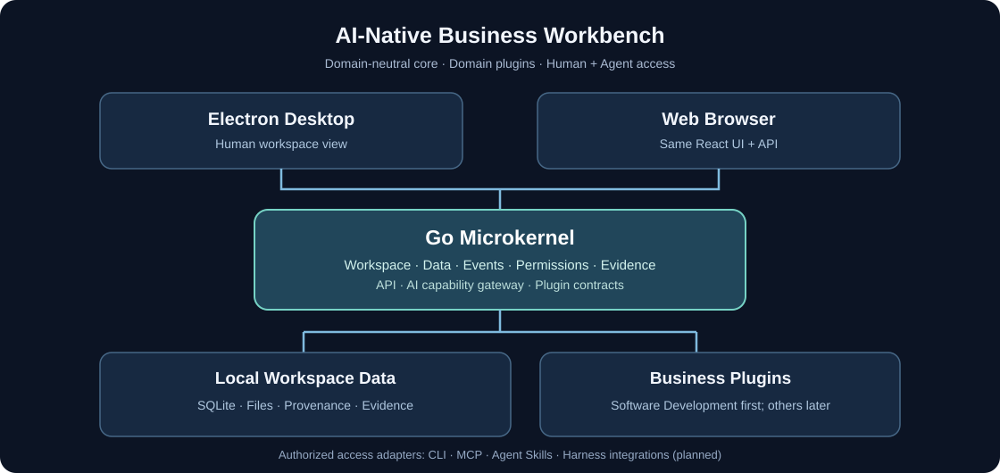

# AI-Native Business Workbench

**A lightweight, extensible AI-native workspace for understanding, running, and governing real-world work.**

[简体中文](./README_zh.md) · English · [Roadmap](./ROADMAP.md)

> **Developing in public:** This repository is updated incrementally from project initialization. The first product baseline is the workbench + domain-neutral microkernel + built-in Software Development plugin. Product capabilities and long-term goals described below are not a claim that everything is implemented today.

> **Let AI handle the details. Keep people in control of the bigger picture.**

## Why this workbench?

AI agents can already write code, search for information, generate content, and carry out increasingly complex tasks. Yet as more work is delegated, it can become harder for the people responsible to answer a few basic questions:

- What has actually changed, and why?
- What has been verified, what is only an AI-generated claim, and what still needs attention?
- Which decisions, constraints, and lessons will survive the next agent session?
- How can agents reuse relevant context without repeatedly reading long histories and documents?
- Can someone understand and steer the work without learning a new collection of AI and process-management techniques?

**AI-Native Business Workbench** is designed around these questions. It connects a human-readable workspace with structured, reusable context for AI-assisted work. The goal is to reduce repetitive coordination and context-reconstruction overhead while preserving visibility, evidence, and human decision-making.

This is not intended to become another agent runtime or to replace the tools people already use to perform their work. It is the workspace that helps people and agents **understand, retain, and govern the outcomes of that work**.

## Product at a glance

The workbench is organized into three layers:

| Layer | Purpose |
| --- | --- |
| **Workbench** | A clear, task-oriented interface for people, available as an Electron desktop client or through a browser. |
| **Microkernel** | An independent Go service for workspaces, data, relationships, events, permissions, evidence, AI capabilities, and plugin lifecycle. |
| **Business plugins** | Installable domain experiences that define the relevant objects, workflows, rules, integrations, and views for a type of work. |

**Software Development** is the first built-in business plugin and the initial product baseline. Future plugins may serve content production, games, manufacturing, automotive engineering, semiconductor workflows, finance, and other domains. Each domain builds on shared infrastructure without being forced into a software-development workflow.

## Designed for people, useful to agents

### Stay informed without micromanaging

Open a workspace to see what matters: the current state, meaningful changes, supporting evidence, unresolved risks, and decisions that need your attention. Explore technical details only when you want to.

### Reuse knowledge instead of rediscovering it

Preserve decisions, constraints, relationships, and lessons as structured, traceable information. Agents can retrieve context relevant to the task rather than re-reading an entire project history. Any claimed improvements in cost or task performance should be evaluated with real workloads, including the workbench's own overhead.

### Assist governance without taking away control

AI can help summarize changes, suggest relationships, organize knowledge, identify missing evidence, and prepare decisions. Verified facts, AI interpretations, and unverified proposals remain distinguishable. Authority to change protected records or approve consequential decisions stays with the appropriate human.

### Start small, extend when necessary

The default experience prioritizes useful views and sensible defaults over mandatory configuration. More advanced users can inspect evidence, adjust policies, work with APIs, and install plugins for their field.

### Work locally, connect when needed

An independent Go backend works with local workspaces and can serve the Web interface itself. The Electron app is an optional desktop view—not a required runtime dependency. The system is designed for Windows and Linux first, with cross-platform portability in mind.

## First business plugin: Software Development

The Software Development plugin brings the workbench to AI-assisted software projects. Its intended capabilities include:

- **Project overview:** project health, recent changes, unresolved issues, and items awaiting a decision.
- **Engineering assets and traceability:** connect requirements, designs, source modules, tests, documents, changes, and evidence.
- **Engineering knowledge and memory:** retain recent facts, outstanding work, and human-confirmed long-term decisions without conflating their lifecycles.
- **Rules and working agreements:** manage project guidance and constraints, including human-friendly editing of `AGENTS.md` where applicable.
- **Change and evidence review:** connect repository changes with test outcomes, claims, impact analysis, and review history.
- **Human governance:** present important proposals, risks, approvals, and their rationale in a clear interface.
- **AI-assisted understanding:** generate helpful explanations and suggestions grounded in inspectable sources.

The underlying engineering-governance concepts originated in **EG (Engineering Governance)**. EG remains the software-development domain's governance approach; the platform's microkernel is domain-neutral.

## How it fits into your workflow



```text
                 Human-facing experiences
             ┌──────────────┬──────────────┐
             │ Electron app │  Web browser │
             └──────┬───────┴──────┬───────┘
                    │  Shared UI/API │
                    └───────┬───────┘
                            │
                    ┌───────▼───────┐
                    │ Go microkernel│
                    │ Local service │
                    └───┬───────┬───┘
                        │       │
            ┌───────────▼┐     ┌▼────────────────┐
            │ Local data │     │ Business plugins│
            │ & evidence │     │ Software Dev ...│
            └────────────┘     └──────────────────┘
                            ▲
                      Authorized APIs
                            │
            Agents / CLI / MCP / Harness adapters
```

The workbench and the API clients operate on the same governed workspace data. Domain plugins extend business behavior; agent/harness adapters extend access channels. These are **different extension mechanisms**.

## Ways to use it

| Mode | Experience |
| --- | --- |
| **Desktop** | Open the Electron client to work with local projects and desktop integrations. |
| **Web** | Open the Web UI served by the Go backend, with no Electron window required. |
| **Headless** | Run the Go service without a graphical interface, for automation and agent-enabled environments. |

The frontend is built with **React and TypeScript** and shared across desktop and browser delivery. The backend is built with **Go**, with **SQLite and workspace-local files** for local-first persistence. The built Web assets can be served by the Go executable.

## AI and ecosystem integration

The platform is designed to expose governed capabilities through stable interfaces. Integrations can include **MCP**, **Agent Skills**, **CLI/HTTP APIs**, and adapters for environments such as **DeepSeekHarness (DSH)** and **Codex**.

These adapters are separate from the business-plugin system. An adapter should use public, authorized service capabilities—not duplicate the governance engine or bypass protected data.

The built-in AI assistant is an optional participant in domain work. It is not a replacement for the host agent's scheduler, team orchestration, or model runtime.

## Principles

1. **Human clarity first.** Make outcomes understandable without demanding expertise in AI infrastructure or project-management methods.
2. **Capture once, reuse contextually.** Avoid unnecessary repetition and duplicated sources of truth.
3. **Evidence before confidence.** Explain where information came from and what has actually been checked.
4. **Human authority over consequential decisions.** Keep permissions and approval boundaries explicit.
5. **Local-first and portable.** Respect existing workspaces, files, and workflows.
6. **Small core, broad possibilities.** Business-specific models and workflows belong in plugins.
7. **Progressive complexity.** Useful defaults for newcomers; inspectable, extensible capabilities for experts.
8. **Measure net benefit.** Count indexing, model, maintenance, and review overhead—not only saved tokens.

## Development direction

The initial product baseline brings together a usable desktop/Web workbench, an independent Go microkernel, local persistence, an optional AI governance assistant, and the **Software Development** built-in plugin. The extensibility contract is designed from the beginning; additional domain plugins and external agent adapters can follow incrementally.

The project is being developed toward this architecture. The descriptions above express the product design and direction and should not be read as a claim that every listed capability is already released.

## Documentation and public development

- [中文 README](./README_zh.md)
- [Public development roadmap](./ROADMAP.md)

The public repository contains product-level information and reviewed screenshots/concept diagrams. Development governance data, internal design notes, and local Agent instructions are kept out of public source and release packages. Installed users can still create independent workspace data when running the product.

Installation instructions, binaries, supported release versions, and a license declaration will be added or updated alongside actual published releases. Until a license is selected and published, do not assume permission to reuse or redistribute the source code.

---

**AI-Native Business Workbench** — *Let AI handle the details. Keep people in control of the bigger picture.*
